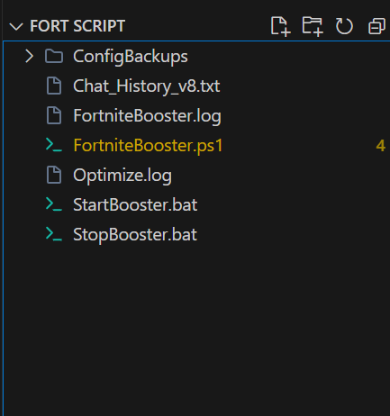

# 🚀 OS-GameBooster
[](https://tokunboajayi.github.io/OS-GameBooster/)


A powerful, hardware-agnostic terminal-based game booster built entirely in PowerShell. OS-GameBooster automatically tunes system memory, prioritizes CPU/GPU resources, disables background bloatware, and minimizes DPC latency for maximum competitive gaming performance.

## ✨ Features


- **Dynamic Process Tracking:** Just pass your game's executable names. The script will wait in the background and boost it the second it launches.
- **Intelligent Standby List Cleaner (ISLC):** Prevents RAM thrashing and micro-stutters by proactively clearing cached memory pools during heavy loads.
- **Hardware-Agnostic:** Designed to dynamically detect and tune Intel, AMD, and Nvidia specific graphics and network hardware.
- **Zero-Distraction UI:** Features a sleek, pure ASCII terminal HUD with real-time telemetry (Memory Allocation, Thermal Core, Boost Cycles).
- **Auto-Restoration:** Uses a robust `try/finally` lifecycle to instantly restore original Windows power limits and priorities when the script closes.

## 🛠 Usage
Run directly from PowerShell with administrator privileges:

```powershell
# Launch boosting mode for specific games
.\GameBooster.ps1 -ProcessNames "cs2", "hl2" -GameName "Source Engine Games"

# Launch in silent mode (perfect for batch files or startup scripts)
.\GameBooster.ps1 -ProcessNames "r5apex" -Silent
```

If run without arguments, it defaults to a pre-configured list of popular competitive games (e.g. Fortnite, Valorant).

## 🧪 Testing & CI
This project uses **Pester** for unit testing and **PSScriptAnalyzer** for code quality. 
Tests are run automatically on every push via GitHub Actions.

To run tests locally:
```powershell
Invoke-Pester .\tests\
```

## 📜 License
Distributed under the MIT License. See `LICENSE` for more information.


